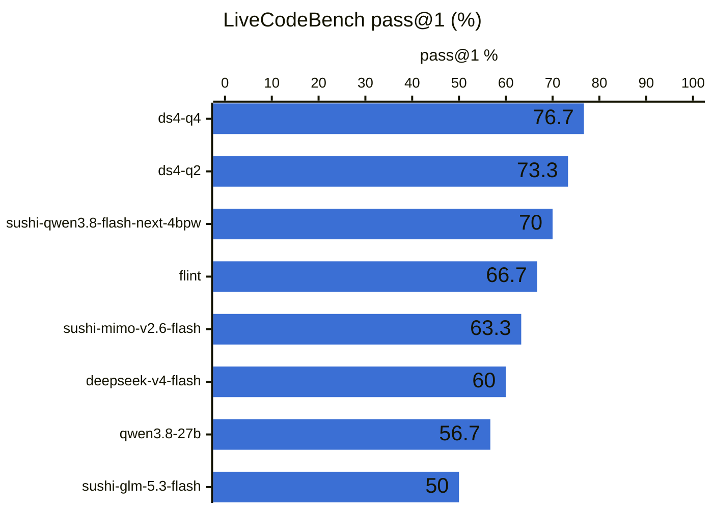
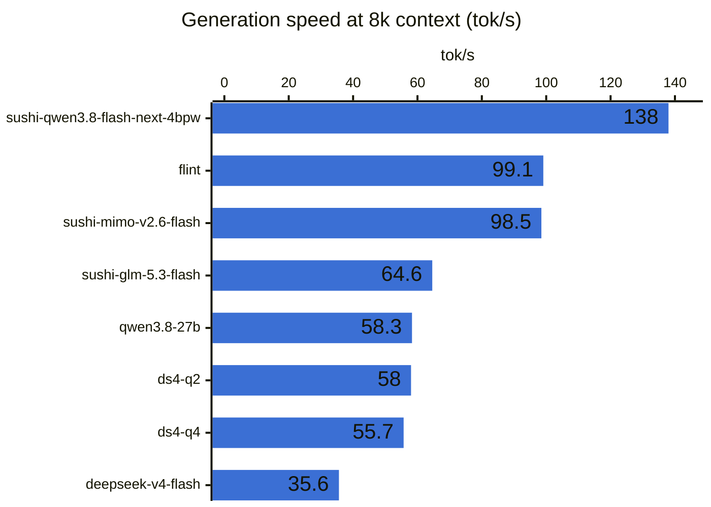

# Benchmark results

Local LLMs on `m5ultra-metal`, generated by `uv run aibench dashboard` on 2026-11-05 19:25 PST. This is the Markdown version of the interactive dashboard in [`dashboard/`](dashboard/); serve that with `uv run aibench dashboard --serve`. The raw numbers are in [`dashboard/data-mac/models.csv`](dashboard/data-mac/models.csv).

Best on LiveCodeBench: **ds4-q4** at 76.7%. 8 of 8 models have finished the overnight profile (livecodebench). The fastest generator at 8k context is **sushi-qwen3.8-flash-next-4bpw** at 138 tok/s.

**Machine:** Mac Studio, Apple M5 Ultra, 256 GB unified memory, macOS 27.2. Engines: llama.cpp b12098 (Metal), [DwarfStar](https://github.com/antirez/ds4) (`ds4`) and [sushi](https://github.com/beamivalice/sushi) 1.4.1 (MLX). No terminal suites (no Docker), and no power or memory figures (aibench reads those only on Linux). The sushi and ds4 models measure speed with `speed-quick-eos`, which is `speed-quick` without `ignore_eos` (both servers reject it). [ANALYSIS-mac.md](ANALYSIS-mac.md) interprets these numbers; [RESULTS-compare.md](RESULTS-compare.md) puts them next to the R9700's.

## Overnight profile

**LiveCodeBench** is an evenly spaced sample of 15 medium and 15 hard v6 problems (Jan–Apr 2025), with a 32k-token budget; **LCB 64k** re-runs the same problems with 64k for models that ran out of room, and **LCB 128k** with 128k for models still cut off at 64k.

| Model | Backend | Quant | Status | LCB pass@1 % | LCB cut off | LCB 64k % | 64k cut off | LCB 128k % | 128k cut off | LCB min |
|:---|:---|:---|:---|---:|---:|---:|---:|---:|---:|---:|
| qwen3.8-27b | metal | UD-Q4_K_XL | done | 56.7 | 12 | 70 | 8 | **86.7** | 2 | 90.9 |
| flint | metal | UD-Q4_K_XL | done | 66.7 | 7 | 80 | 2 | 73.3 | 0 | 40.7 |
| deepseek-v4-flash | metal | UD-Q2_K_XL | done | 60 | 10 | 83.3 | 0 | — | — | 121 |
| ds4-q2 | ds4 | IQ2_XXS | done | 73.3 | 8 | 86.7 | 2 | 83.3 | 1 | 174 |
| sushi-glm-5.3-flash | sushi | 2.4bpw | done | 50 | 15 | 60 | 11 | — | — | 110 |
| sushi-mimo-v2.6-flash | sushi | 2.3bpw | done | 63.3 | 9 | 56.7 | 11 | — | — | 75.8 |
| sushi-qwen3.8-flash-next-4bpw | sushi | 4bpw | done | 70 | 1 | — | — | — | — | 27.3 |
| ds4-q4 | ds4 | Q4_K | done | **76.7** | 7 | **93.3** | 0 | — | — | 168 |

"Cut off" counts LiveCodeBench answers that hit `max_tokens` before finishing. Those score as failures, so the cap pulls down models that think at length. "Quant" is the GGUF quantization each model ran at; `UD-` marks Unsloth Dynamic quants, which keep sensitive layers at higher precision. [TODO.md](TODO.md) has more caveats.

## Speed and quick profile

Server-measured speeds from each model's latest `speed-quick` run (the server's own timings where it reports them, otherwise measured from the stream), the raw llama-bench numbers for llama.cpp models, a 40-problem HumanEval+ subset.

| Model | Backend | Quant | HumanEval % | HumanEval+ % | Prompt 512 tok/s | Gen @512 tok/s | Prompt 8k tok/s | Gen @8k tok/s | TTFT @8k s | llama-bench pp512 | llama-bench tg128 |
|:---|:---|:---|---:|---:|---:|---:|---:|---:|---:|---:|---:|
| qwen3.8-27b | metal | UD-Q4_K_XL | 100 | 95 | 815 | 93.9 | 1029 | 58.3 | 7.99 | 1116 | 46.8 |
| flint | metal | UD-Q4_K_XL | 97.5 | 95 | **4079** | 100 | **4335** | 99.1 | **1.93** | **4781** | **118** |
| deepseek-v4-flash | metal | UD-Q2_K_XL | 100 | **97.5** | 852 | 36.0 | 820 | 35.6 | 10.0 | 977 | 39.8 |
| ds4-q2 | ds4 | IQ2_XXS | 97.5 | **97.5** | 796 | 62.5 | 1044 | 58.0 | 7.84 | — | — |
| sushi-glm-5.3-flash | sushi | 2.4bpw | 100 | **97.5** | 1203 | 66.8 | 1629 | 64.6 | 5.09 | — | — |
| sushi-mimo-v2.6-flash | sushi | 2.3bpw | 92.5 | 90 | 1787 | 61.8 | 2827 | 98.5 | 2.96 | — | — |
| sushi-qwen3.8-flash-next-4bpw | sushi | 4bpw | 97.5 | 95 | 1106 | **134** | 3508 | **138** | 2.39 | — | — |
| ds4-q4 | ds4 | Q4_K | 100 | **97.5** | 605 | 62.7 | 922 | 55.7 | 8.95 | — | — |

Bold marks the best value in a column. — means the model hasn't run that suite yet.
