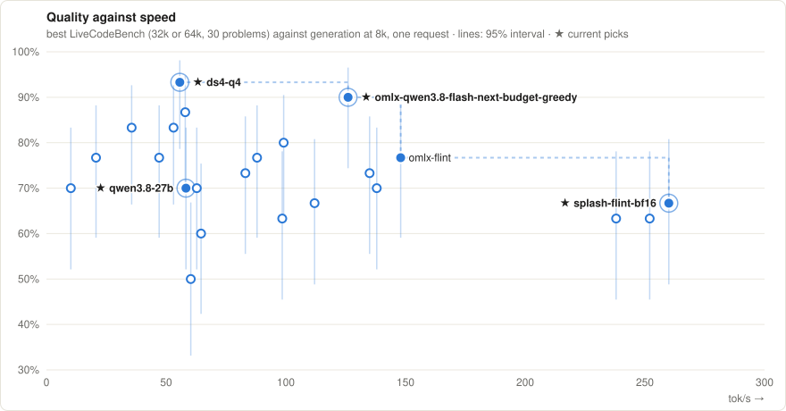
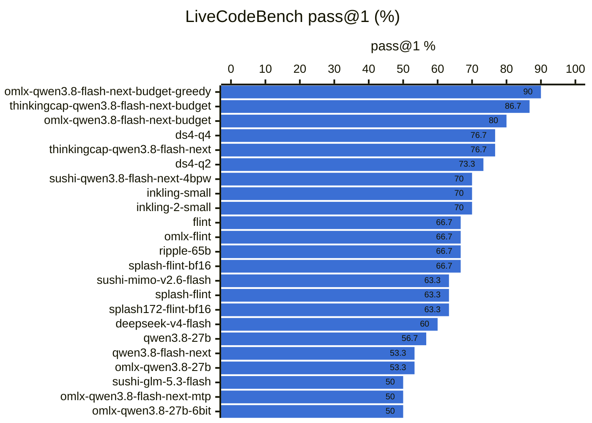
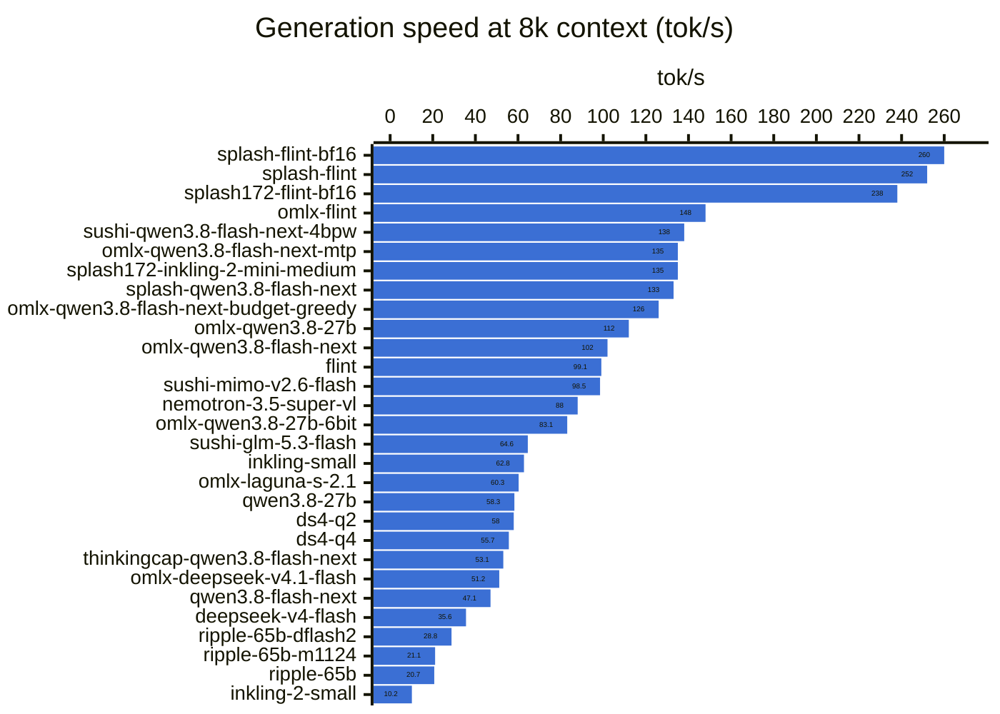

# Benchmark results

Local LLMs on `m5ultra-metal`, generated by `uv run aibench dashboard` on 2026-11-25 13:22 PST. This is the Markdown version of the interactive dashboard in [`dashboard/`](dashboard/); serve that with `uv run aibench dashboard --serve`. The raw numbers are in [`dashboard/data-mac/models.csv`](dashboard/data-mac/models.csv).

Best on LiveCodeBench: **omlx-qwen3.8-flash-next-budget-greedy** at 90%. 23 of 38 models have finished the overnight profile (livecodebench). The fastest generator at 8k context is **splash-flint-bf16** at 260 tok/s.

**Machine:** Mac Studio, Apple M5 Ultra, 256 GB unified memory, macOS 27.2. Engines: llama.cpp b12098 (Metal), [DwarfStar](https://github.com/antirez/ds4) (`ds4`), [sushi](https://github.com/beamivalice/sushi) 1.4.1 (MLX), and [oMLX](https://github.com/jundot/omlx) 0.7.3 (MLX). Terminal suites run in OrbStack (Docker, linux/arm64). No power or memory figures (aibench reads those only on Linux). The sushi, ds4 and oMLX models measure speed with `speed-quick-eos`, which is `speed-quick` without `ignore_eos` (both servers reject it). [ANALYSIS-mac.md](ANALYSIS-mac.md) interprets these numbers; [RESULTS-compare.md](RESULTS-compare.md) puts them next to the R9700's.

## Current picks

Which model to use for what on this machine, from the analysis. LiveCodeBench scores carry their 95% interval in brackets.

| Role | Model | LiveCodeBench | terminal-x3 | Gen @8k | Why |
|---|---|---|---|---|---|
| **Hard problems and planning** | **omlx-qwen3.8-flash-next-budget-greedy** | 90% at 32k (74–97) | 98.1% | 126 tok/s | Qwen3.8-Flash-Next on oMLX with greedy decoding and a 24,576-token thinking budget, as ai-swap serves it (qwen3.8-flash-next). 90% at 32k, 53 of 60 on LCB-60, ties ds4-q4 in a quarter to half the time. 127 tok/s at 8k with MTP as benchmarked; ai-swap serves it without MTP (~102 tok/s, better with several agents). |
| **Executors, fast all-round** | **splash-flint-bf16** | 66.7% at 32k (49–81) | — | 260 tok/s | flint on Splash 1.7.0 with bf16 activations, ai-swap's `flint` since Nov 24: 66.7% at 32k (70% on LCB-60 at 64k on oMLX), 94.4% terminal-x3 through ai-swap in 3.6 min, 260 tok/s at 8k and 453 in total with 8 in flight, from 40 GB. `flint-omlx` stays as the fallback. |
| **Second executor** | **splash172-inkling-2-mini-medium** | — | 98.1% | 135 tok/s | Inkling 2 Mini at medium effort on Splash 1.7.2, ai-swap's `inkling-2-mini` (on demand) since Nov 25: 70% on LCB-60 at 64k (flint's score), 98.1% terminal-x3 in 5 min, 135 tok/s at 8k and 267 in total with 8 in flight, from ~20 GB. |
| **Second opinion, escalation** | **ds4-q4** | 93.3% at 64k (79–98) | 100% | 55.7 tok/s | DeepSeek V4 Flash Q4 on DwarfStar: 93.3% at 64k (86.7% on LCB-60), 100% terminal-x3. A different model that fails on different problems, but ~4x slower than tuned Flash-Next. |
| **Hard problems, small footprint** | **qwen3.8-27b** | 70% at 64k (52–83) | — | 58.3 tok/s | 86.7% at 128k from 17.5 GB, but 39k-token answers: give it a 128k budget. oMLX doubles its speed at 8k. |

Up and to the right is better. Labeled models are the ones nothing beats on both, joined by the dashed line; ★ marks the current picks. The [dashboard](dashboard/) has the same chart with hover details.

## Overnight profile

**LiveCodeBench** is an evenly spaced sample of 15 medium and 15 hard v6 problems (Jan–Apr 2025), with a 32k-token budget; **LCB 64k** re-runs the same problems with 64k for models that ran out of room, and **LCB 128k** with 128k for models still cut off at 64k. **LCB-60** doubles the sample (30 medium + 30 hard, a superset of the 30) for the closest comparisons, at 32k and 64k.

| Model | Backend | Quant | Status | terminal-x3 % | as run % | LCB pass@1 % | LCB cut off | LCB 64k % | 64k cut off | LCB 128k % | 128k cut off | terminal-x3 min | LCB min | LCB-60 % | LCB-60 cut off | LCB-60 min | LCB-60 64k % | LCB-60 64k min |
|:---|:---|:---|:---|---:|---:|---:|---:|---:|---:|---:|---:|---:|---:|---:|---:|---:|---:|---:|
| qwen3.8-27b | metal | UD-Q4_K_XL | done | — | — | 56.7 39–73 | 12 | 70 52–83 | 8 | **86.7** 70–95 | 2 | — | 90.9 | — | — | — | — | — |
| flint | metal | UD-Q4_K_XL | done | — | — | 66.7 49–81 | 7 | 80 63–90 | 2 | 73.3 56–86 | 0 | — | 40.7 | — | — | — | — | — |
| deepseek-v4-flash | metal | UD-Q2_K_XL | done | — | — | 60 42–75 | 10 | 83.3 66–93 | 0 | — | — | — | 121 | — | — | — | — | — |
| ds4-q2 | ds4 | IQ2_XXS | done | — | — | 73.3 56–86 | 8 | 86.7 70–95 | 2 | 83.3 66–93 | 1 | — | 174 | — | — | — | — | — |
| sushi-glm-5.3-flash | sushi | 2.4bpw | done | — | — | 50 33–67 | 15 | 60 42–75 | 11 | 63.3 45–78 | 8 | — | 110 | — | — | — | — | — |
| sushi-mimo-v2.6-flash | sushi | 2.3bpw | done | — | — | 63.3 45–78 | 9 | 56.7 39–73 | 11 | 70 52–83 | 5 | — | 75.8 | — | — | — | — | — |
| sushi-qwen3.8-flash-next-4bpw | sushi | 4bpw | done | — | — | 70 52–83 | 1 | 63.3 45–78 | 0 | — | — | — | 27.3 | — | — | — | — | — |
| ds4-q4 | ds4 | Q4_K | done | **100** | 100 | 76.7 59–88 | 7 | **93.3** 79–98 | 0 | — | — | 35.4 | 168 | — | — | — | 86.7 76–93 | 346 |
| qwen3.8-flash-next | metal | UD-Q4_K_XL | done | — | — | 53.3 36–70 | 14 | 76.7 59–88 | 5 | — | — | — | 90.3 | — | — | — | — | — |
| inkling-small | omlx | — | done | — | — | 70 52–83 | 4 | 70 52–83 | 0 | — | — | — | 61.4 | — | — | — | — | — |
| omlx-qwen3.8-flash-next-mtp | omlx | — | done | — | — | 50 33–67 | 14 | 73.3 56–86 | 7 | — | — | — | 59.4 | — | — | — | — | — |
| omlx-flint | omlx | — | done | 96.3 | 96.3 | 66.7 49–81 | 7 | 76.7 59–88 | 1 | — | — | 7.35 | 34.6 | — | — | — | 70 57–80 | 90.4 |
| omlx-qwen3.8-27b | omlx | — | done | — | — | 53.3 36–70 | 13 | 66.7 49–81 | 8 | 83.3 66–93 | 3 | — | 86.1 | — | — | — | — | — |
| omlx-qwen3.8-27b-6bit | omlx | — | done | — | — | 50 33–67 | 13 | 73.3 56–86 | 7 | — | — | — | 102 | — | — | — | — | — |
| ripple-65b | metal-b12192 | Q4_K_M | done | **100** | 100 | 66.7 49–81 | 8 | 76.7 59–88 | 2 | — | — | 31.1 | 144 | — | — | — | — | — |
| inkling-2-small | metal-inkling2 | UD-Q2_K_XL | done | — | — | 70 52–83 | 7 | — | — | — | — | — | 323 | — | — | — | — | — |
| omlx-qwen3.8-flash-next-budget | omlx | — | done | — | — | 80 63–90 | 1 | — | — | — | — | — | 52.7 | — | — | — | — | — |
| omlx-qwen3.8-flash-next-budget-greedy | omlx | — | done | 98.1 | 98.1 | **90** 74–97 | 0 | — | — | — | — | 14.8 | 46.8 | **88.3** 78–94 | 0 | 87.3 | — | — |
| thinkingcap-qwen3.8-flash-next | metal | Q4_K_M | done | 98.1 | 98.1 | 76.7 59–88 | 7 | 83.3 66–93 | 2 | — | — | 11.2 | 60.4 | — | — | — | — | — |
| thinkingcap-qwen3.8-flash-next-budget | metal | Q4_K_M | done | — | — | 86.7 70–95 | 0 | — | — | — | — | — | 55.9 | — | — | — | — | — |
| splash-flint | splash | — | done | 94.4 | 94.4 | 63.3 45–78 | 7 | — | — | — | — | 6.29 | 20.5 | — | — | — | — | — |
| splash-flint-bf16 | splash | — | done | — | — | 66.7 49–81 | 7 | — | — | — | — | — | 19.8 | — | — | — | — | — |
| splash172-flint-bf16 | splash-172 | — | done | — | — | 63.3 45–78 | 7 | — | — | — | — | — | 21.4 | — | — | — | — | — |
| nemotron-3.5-super-vl | metal-b12192 | Q4_0 | not run | — | — | — | — | 76.7 59–88 | 4 | — | — | — | — | — | — | — | — | — |
| omlx-deepseek-v4.1-flash | omlx | — | not run | — | — | — | — | — | — | — | — | — | — | — | — | — | **90** 80–95 | 169 |
| omlx-deepseek-v4.1-flash-budget | omlx | — | not run | — | — | — | — | — | — | — | — | — | — | **88.3** 78–94 | 1 | 109 | — | — |
| omlx-laguna-s-2.1 | omlx | — | not run | 96.3 | 96.3 | — | — | 50 33–67 | 0 | — | — | 17.4 | — | — | — | — | — | — |
| omlx-qwen3.8-flash-next | omlx | — | not run | — | — | — | — | — | — | — | — | — | — | — | — | — | — | — |
| omlx-qwen3.8-flash-next-6bit-budget-greedy | omlx | — | not run | — | — | — | — | — | — | — | — | — | — | 86.7 76–93 | 0 | 95.7 | — | — |
| omlx-qwen3.8-flash-next-budget64k | omlx | — | not run | — | — | — | — | 86.7 70–95 | 0 | — | — | — | — | — | — | — | — | — |
| omlx-qwen3.8-flash-next-budget64k-greedy | omlx | — | not run | — | — | — | — | 90 74–97 | 0 | — | — | — | — | — | — | — | 86.7 76–93 | 155 |
| ripple-65b-dflash2 | metal-1124 | Q4_K_M | not run | — | — | — | — | — | — | — | — | — | — | — | — | — | — | — |
| ripple-65b-m1124 | metal-1124 | Q4_K_M | not run | — | — | — | — | — | — | — | — | — | — | — | — | — | — | — |
| splash-qwen3.8-flash-next | splash | — | not run | **100** | 100 | — | — | — | — | — | — | 6.30 | — | 85 74–92 | 0 | 52.7 | — | — |
| splash172-inkling-2-mini-medium | splash-172 | — | not run | 98.1 | 98.1 | — | — | — | — | — | — | 5.09 | — | — | — | — | 70 57–80 | 85.2 |
| swap-flint | swap | — | not run | 94.4 | 94.4 | — | — | — | — | — | — | 3.64 | — | — | — | — | — | — |
| swap-qwen3.8-flash-next | swap | — | not run | 98.1 | 98.1 | — | — | — | — | — | — | 19.6 | — | 86.7 76–93 | 0 | 80.3 | — | — |
| thinkingcap-qwen3.8-flash-next-budget64k | metal | Q4_K_M | not run | — | — | — | — | 86.7 70–95 | 0 | — | — | — | — | — | — | — | — | — |

The small numbers under each LiveCodeBench score are its 95% interval (Wilson), from the run's own problem count. With 30 problems one problem is 3.3 points and an 80% score spans about 63–90%, so two models whose intervals overlap widely can't be ranked by these runs: read them as a tie. LCB-60's 60 problems narrow that by about a third.

"Cut off" counts LiveCodeBench answers that hit `max_tokens` before finishing. Those score as failures, so the cap pulls down models that think at length. "Quant" is the GGUF quantization each model ran at; `UD-` marks Unsloth Dynamic quants, which keep sensitive layers at higher precision. [TODO.md](TODO.md) has more caveats.

## Speed and quick profile

Server-measured speeds from each model's latest `speed-quick` run (the server's own timings where it reports them, otherwise measured from the stream), the raw llama-bench numbers for llama.cpp models, a 40-problem HumanEval+ subset.

| Model | Backend | Quant | HumanEval % | HumanEval+ % | Terminal % | Prompt 512 tok/s | Gen @512 tok/s | Prompt 8k tok/s | Gen @8k tok/s | TTFT @8k s | llama-bench pp512 | llama-bench tg128 |
|:---|:---|:---|---:|---:|---:|---:|---:|---:|---:|---:|---:|---:|
| qwen3.8-27b | metal | UD-Q4_K_XL | 100 | 95 | — | 815 | 93.9 | 1029 | 58.3 | 7.99 | 1116 | 46.8 |
| flint | metal | UD-Q4_K_XL | 97.5 | 95 | — | 4079 | 100 | 4335 | 99.1 | 1.93 | **4781** | **118** |
| deepseek-v4-flash | metal | UD-Q2_K_XL | 100 | **97.5** | — | 852 | 36.0 | 820 | 35.6 | 10.0 | 977 | 39.8 |
| ds4-q2 | ds4 | IQ2_XXS | 97.5 | **97.5** | — | 796 | 62.5 | 1044 | 58.0 | 7.84 | — | — |
| sushi-glm-5.3-flash | sushi | 2.4bpw | 100 | **97.5** | — | 1203 | 66.8 | 1629 | 64.6 | 5.09 | — | — |
| sushi-mimo-v2.6-flash | sushi | 2.3bpw | 92.5 | 90 | — | 1787 | 61.8 | 2827 | 98.5 | 2.96 | — | — |
| sushi-qwen3.8-flash-next-4bpw | sushi | 4bpw | 97.5 | 95 | — | 1106 | 134 | 3508 | 138 | 2.39 | — | — |
| ds4-q4 | ds4 | Q4_K | 100 | **97.5** | — | 605 | 62.7 | 922 | 55.7 | 8.95 | — | — |
| qwen3.8-flash-next | metal | UD-Q4_K_XL | 100 | **97.5** | — | 1012 | 49.7 | 1400 | 47.1 | 5.92 | 1595 | 47.4 |
| inkling-small | omlx | — | 100 | **97.5** | — | 709 | 66.9 | 2050 | 62.8 | 4.00 | — | — |
| omlx-qwen3.8-flash-next-mtp | omlx | — | 100 | **97.5** | — | 1828 | 180 | 3934 | 135 | 2.08 | — | — |
| omlx-flint | omlx | — | 97.5 | 95 | 83.3 | 1862 | 163 | 5202 | 148 | 1.59 | — | — |
| omlx-qwen3.8-27b | omlx | — | 100 | 95 | — | 1149 | 102 | 1868 | 112 | 4.38 | — | — |
| omlx-qwen3.8-27b-6bit | omlx | — | — | — | — | 1044 | 100 | 1670 | 83.1 | 4.90 | — | — |
| ripple-65b | metal-b12192 | Q4_K_M | — | — | **100** | 430 | 21.5 | 434 | 20.7 | 19.0 | — | — |
| inkling-2-small | metal-inkling2 | UD-Q2_K_XL | 100 | **97.5** | — | 288 | 13.5 | 99.5 | 10.2 | 82.7 | — | — |
| omlx-qwen3.8-flash-next-budget | omlx | — | — | — | — | — | — | — | — | — | — | — |
| omlx-qwen3.8-flash-next-budget-greedy | omlx | — | — | — | — | 1860 | 152 | 3973 | 126 | 2.06 | — | — |
| thinkingcap-qwen3.8-flash-next | metal | Q4_K_M | 97.5 | **97.5** | — | 970 | 54.0 | 1401 | 53.1 | 5.89 | 1605 | 55.3 |
| thinkingcap-qwen3.8-flash-next-budget | metal | Q4_K_M | — | — | — | — | — | — | — | — | — | — |
| splash-flint | splash | — | — | — | — | **9224** | 280 | **13165** | 252 | **0.64** | — | — |
| splash-flint-bf16 | splash | — | — | — | — | 9165 | 270 | 12798 | **260** | 0.66 | — | — |
| splash172-flint-bf16 | splash-172 | — | — | — | — | 9125 | **299** | 12573 | 238 | 0.68 | — | — |
| nemotron-3.5-super-vl | metal-b12192 | Q4_0 | — | — | **100** | 1023 | 85.1 | 1250 | 88.0 | 6.59 | — | — |
| omlx-deepseek-v4.1-flash | omlx | — | — | — | — | 493 | 51.9 | 618 | 51.2 | 27.3 | — | — |
| omlx-deepseek-v4.1-flash-budget | omlx | — | — | — | — | — | — | — | — | — | — | — |
| omlx-laguna-s-2.1 | omlx | — | — | — | **100** | 1401 | 62.2 | 2446 | 60.3 | 3.36 | — | — |
| omlx-qwen3.8-flash-next | omlx | — | — | — | — | 1879 | 111 | 4164 | 102 | 1.97 | — | — |
| omlx-qwen3.8-flash-next-6bit-budget-greedy | omlx | — | — | — | — | — | — | — | — | — | — | — |
| omlx-qwen3.8-flash-next-budget64k | omlx | — | — | — | — | — | — | — | — | — | — | — |
| omlx-qwen3.8-flash-next-budget64k-greedy | omlx | — | — | — | — | — | — | — | — | — | — | — |
| ripple-65b-dflash2 | metal-1124 | Q4_K_M | — | — | — | 437 | 41.3 | 448 | 28.8 | 18.4 | — | — |
| ripple-65b-m1124 | metal-1124 | Q4_K_M | — | — | — | 434 | 21.8 | 438 | 21.1 | 18.9 | — | — |
| splash-qwen3.8-flash-next | splash | — | — | — | — | 3281 | 147 | 4880 | 133 | 1.68 | — | — |
| splash172-inkling-2-mini-medium | splash-172 | — | — | — | — | 4836 | 158 | 6357 | 135 | 1.32 | — | — |
| swap-flint | swap | — | — | — | — | — | — | — | — | — | — | — |
| swap-qwen3.8-flash-next | swap | — | — | — | — | — | — | — | — | — | — | — |
| thinkingcap-qwen3.8-flash-next-budget64k | metal | Q4_K_M | — | — | — | — | — | — | — | — | — | — |

Bold marks the best value in a column. — means the model hasn't run that suite yet.
