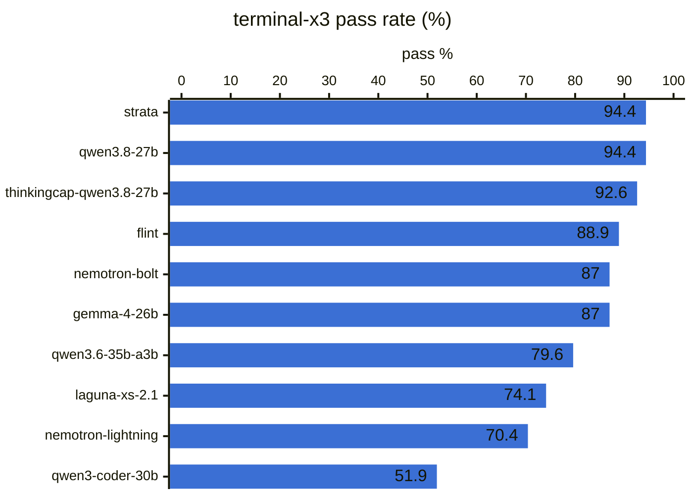
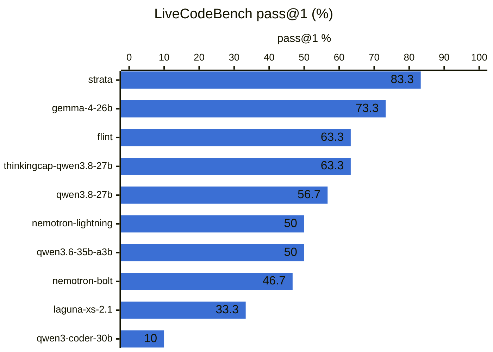
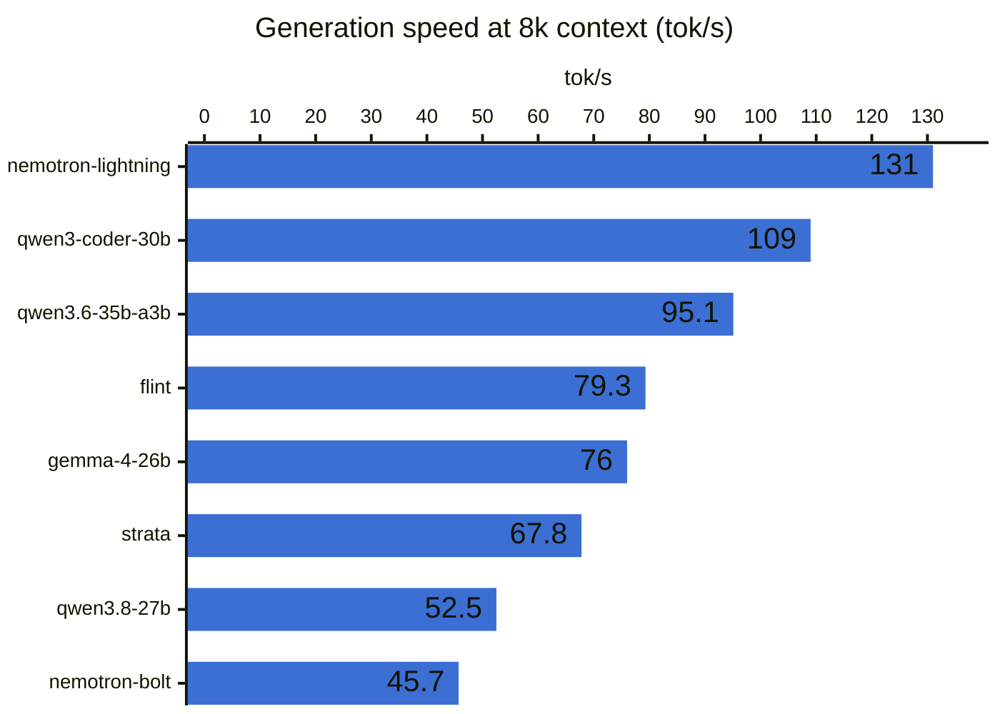

# Benchmark results

Local LLMs on `r9700-vulkan`, generated by `uv run aibench dashboard` on 2026-10-25 08:55 PDT. This is the Markdown version of the interactive dashboard in [`dashboard/`](dashboard/); serve that with `uv run aibench dashboard --serve`. The raw numbers are in [`dashboard/data/models.csv`](dashboard/data/models.csv).

Best on terminal-x3: **strata** and **qwen3.8-27b** at 94.4%. Best on LiveCodeBench: **strata** at 83.3%. 10 of 10 models have finished the overnight profile. The fastest generator at 8k context is **nemotron-lightning** at 131 tok/s.

## Overnight profile

**terminal-x3** runs 18 agentic shell tasks three times each (54 episodes) in a Docker sandbox. **LiveCodeBench** is an evenly spaced sample of 15 medium and 15 hard v6 problems (Jan–Apr 2025).

| Model | Status | terminal-x3 % | LCB pass@1 % | LCB cut off | LCB problems | terminal-x3 min | LCB min |
|:---|:---|---:|---:|---:|---:|---:|---:|
| nemotron-lightning | done | 70.4 | 50 | 16 | 30 | 19.0 | 101 |
| nemotron-bolt | done | 87.0 | 46.7 | 17 | 30 | 85.2 | 137 |
| flint | done | 88.9 | 63.3 | 7 | 30 | 43.8 | 77.6 |
| strata | done | **94.4** | **83.3** | 0 | 30 | 49.0 | 118 |
| qwen3.8-27b | done | **94.4** | 56.7 | 12 | 30 | 25.1 | 181 |
| qwen3.6-35b-a3b | done | 79.6 | 50 | 16 | 30 | 11.3 | 104 |
| gemma-4-26b | done | 87.0 | 73.3 | 2 | 30 | 80.0 | 69.3 |
| qwen3-coder-30b | done | 51.9 | 10 | 0 | 30 | 23.0 | 20.7 |
| thinkingcap-qwen3.8-27b | done | 92.6 | 63.3 | 11 | 30 | 17.5 | 158 |
| laguna-xs-2.1 | done | 74.1 | 33.3 | 7 | 30 | 33.8 | 88.8 |

"Cut off" counts LiveCodeBench answers that hit `max_tokens` (32,768) before finishing. Those score as failures, so the cap pulls down models that think at length. Strata loaded while VRAM from the previous model was still in use, so read its numbers with care. [TODO.md](TODO.md) has more caveats.

## Speed and quick profile

Server-measured speeds from each model's latest `speed-quick` run (llama.cpp timings), plus a 40-problem HumanEval+ subset and six terminal tasks.

| Model | Backend | HumanEval % | HumanEval+ % | Terminal % | Prompt 512 tok/s | Gen @512 tok/s | Prompt 8k tok/s | Gen @8k tok/s | TTFT @8k s |
|:---|:---|---:|---:|---:|---:|---:|---:|---:|---:|
| nemotron-lightning | swap | 100 | **97.5** | 83.3 | 1460 | 126 | 3023 | **131** | 2.85 |
| nemotron-bolt | swap | 100 | **97.5** | **100** | 563 | 53.6 | 1093 | 45.7 | 7.84 |
| flint | swap | 100 | **97.5** | 83.3 | 2649 | 83.0 | 3391 | 79.3 | 2.54 |
| strata | strata | 95 | 95 | **100** | 158 | 63.5 | 780 | 67.8 | 10.5 |
| qwen3.8-27b | swap | 100 | **97.5** | **100** | 476 | 69.1 | 907 | 52.5 | 9.46 |
| qwen3.6-35b-a3b | swap | 97.5 | 95 | 66.7 | 2089 | 97.3 | **3559** | 95.1 | **2.46** |
| gemma-4-26b | swap | 100 | **97.5** | 83.3 | 2032 | 81.5 | 3482 | 76.0 | 2.60 |
| qwen3-coder-30b | swap | 100 | **97.5** | 66.7 | **3634** | **127** | 3288 | 109 | 2.68 |
| thinkingcap-qwen3.8-27b | swap | — | — | — | — | — | — | — | — |
| laguna-xs-2.1 | swap | — | — | — | — | — | — | — | — |

Bold marks the best value in a column. — means the model hasn't run that suite yet.
