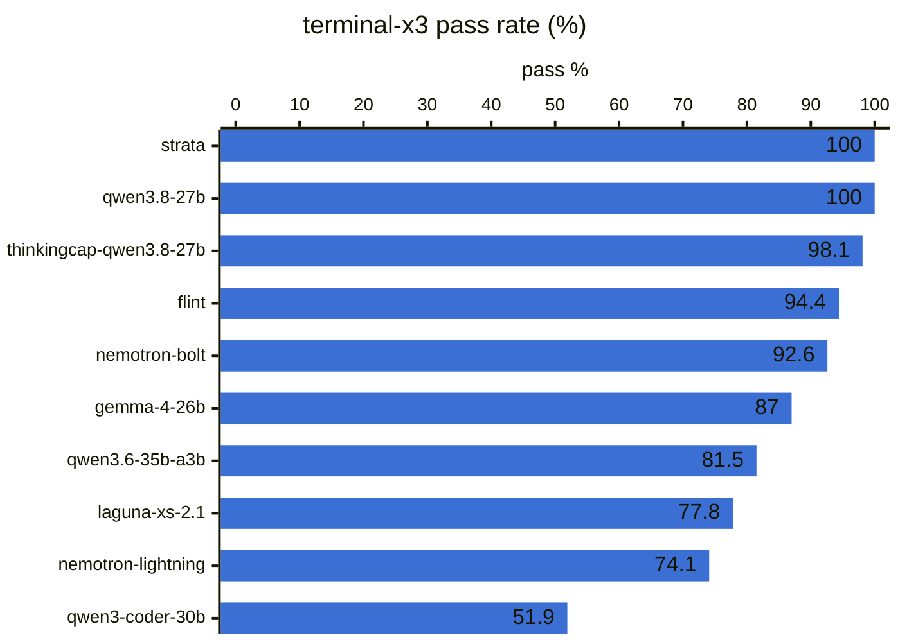
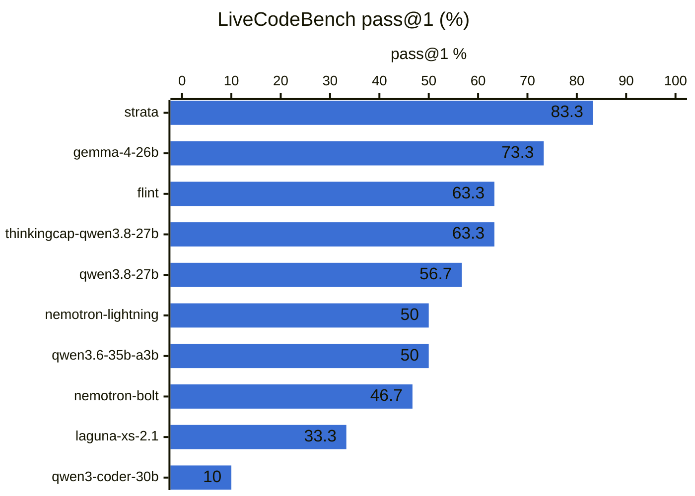
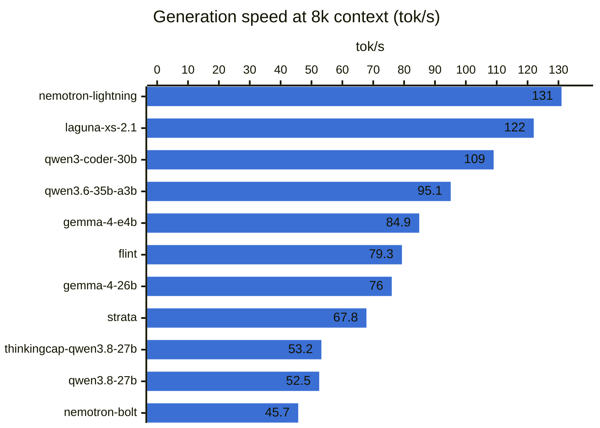

# Benchmark results

Local LLMs on `r9700-vulkan`, generated by `uv run aibench dashboard` on 2026-10-26 06:21 PDT. This is the Markdown version of the interactive dashboard in [`dashboard/`](dashboard/); serve that with `uv run aibench dashboard --serve`. The raw numbers are in [`dashboard/data/models.csv`](dashboard/data/models.csv).

Best on terminal-x3: **strata** and **qwen3.8-27b** at 100%. Best on LiveCodeBench: **strata** at 83.3%. 10 of 11 models have finished the overnight profile. The fastest generator at 8k context is **nemotron-lightning** at 131 tok/s.

## Overnight profile

**terminal-x3** runs 18 agentic shell tasks three times each (54 episodes) in a Docker sandbox. Its `backup-rotation` task was broken in the original runs (it failed any model that tested its script). The fixed task was re-run on its own, and the scores here use that result; "as run" is the original score. **LiveCodeBench** is an evenly spaced sample of 15 medium and 15 hard v6 problems (Jan–Apr 2025), with a 32k-token budget; **LCB 64k** re-runs the same problems with 64k for models that ran out of room.

| Model | Status | terminal-x3 % | as run % | LCB pass@1 % | LCB cut off | LCB 64k % | 64k cut off | terminal-x3 min | LCB min |
|:---|:---|---:|---:|---:|---:|---:|---:|---:|---:|
| nemotron-lightning | done | 74.1 | 70.4 | 50 | 16 | — | — | 19.0 | 101 |
| nemotron-bolt | done | 92.6 | 87.0 | 46.7 | 17 | — | — | 85.2 | 137 |
| flint | done | 94.4 | 88.9 | 63.3 | 7 | 66.7 | 1 | 43.8 | 77.6 |
| strata | done | **100** | 94.4 | **83.3** | 0 | — | — | 49.0 | 118 |
| qwen3.8-27b | done | **100** | 94.4 | 56.7 | 12 | 66.7 | 9 | 25.1 | 181 |
| qwen3.6-35b-a3b | done | 81.5 | 79.6 | 50 | 16 | 66.7 | 7 | 11.3 | 104 |
| gemma-4-26b | done | 87.0 | 87.0 | 73.3 | 2 | 66.7 | 1 | 80.0 | 69.3 |
| qwen3-coder-30b | done | 51.9 | 51.9 | 10 | 0 | — | — | 23.0 | 20.7 |
| thinkingcap-qwen3.8-27b | done | 98.1 | 92.6 | 63.3 | 11 | **80** | 5 | 17.5 | 158 |
| laguna-xs-2.1 | done | 77.8 | 74.1 | 33.3 | 7 | — | — | 33.8 | 88.8 |
| gemma-4-e4b | not run | — | — | — | — | — | — | — | — |

"Cut off" counts LiveCodeBench answers that hit `max_tokens` before finishing. Those score as failures, so the cap pulls down models that think at length. [TODO.md](TODO.md) has more caveats.

## Speed and quick profile

Server-measured speeds from each model's latest `speed-quick` run (llama.cpp timings), plus a 40-problem HumanEval+ subset and six terminal tasks.

| Model | Backend | HumanEval % | HumanEval+ % | Terminal % | Prompt 512 tok/s | Gen @512 tok/s | Prompt 8k tok/s | Gen @8k tok/s | TTFT @8k s |
|:---|:---|---:|---:|---:|---:|---:|---:|---:|---:|
| nemotron-lightning | swap | 100 | **97.5** | 83.3 | 1460 | 126 | 3023 | **131** | 2.85 |
| nemotron-bolt | swap | 100 | **97.5** | **100** | 563 | 53.6 | 1093 | 45.7 | 7.84 |
| flint | swap | 100 | **97.5** | 83.3 | 2649 | 83.0 | 3391 | 79.3 | 2.54 |
| strata | strata | 95 | 95 | **100** | 158 | 63.5 | 780 | 67.8 | 10.5 |
| qwen3.8-27b | swap | 100 | **97.5** | **100** | 476 | 69.1 | 907 | 52.5 | 9.46 |
| qwen3.6-35b-a3b | swap | 97.5 | 95 | 66.7 | 2089 | 97.3 | 3559 | 95.1 | 2.46 |
| gemma-4-26b | swap | 100 | **97.5** | 83.3 | 2032 | 81.5 | 3482 | 76.0 | 2.60 |
| qwen3-coder-30b | swap | 100 | **97.5** | 66.7 | **3634** | 127 | 3288 | 109 | 2.68 |
| thinkingcap-qwen3.8-27b | swap | 100 | 95 | — | 551 | 56.8 | 902 | 53.2 | 9.53 |
| laguna-xs-2.1 | swap | 100 | **97.5** | — | 2196 | **131** | 3360 | 122 | 2.60 |
| gemma-4-e4b | swap | 100 | 95 | 50 | 2590 | 85.8 | **4349** | 84.9 | **2.01** |

Bold marks the best value in a column. — means the model hasn't run that suite yet.

## `r9700-vulkan` vs `r9700-rocm`

The same GGUFs and llama.cpp release (b11850) on both backends. Server speeds come from `speed-quick`; the llama-bench columns are raw kernel throughput (`kernels` / `kernels-rocm`, no server).

| Model | Gen @8k r9700-vulkan | r9700-rocm | Δ | Prompt 8k r9700-vulkan | r9700-rocm | Δ | llama-bench tg128 r9700-vulkan | r9700-rocm | llama-bench pp512 r9700-vulkan | r9700-rocm |
|:---|---:|---:|---:|---:|---:|---:|---:|---:|---:|---:|
| flint | 79.3 | 62.4 | -21% | 3391 | 3057 | -10% | 91.4 | 73.6 | 3388 | 3413 |
| gemma-4-26b | 76.0 | 66.1 | -13% | 3482 | 1969 | -43% | 94.1 | 84.1 | 3604 | 2237 |
| nemotron-lightning | 131 | 142 | +8% | 3023 | 2774 | -8% | 122 | 109 | 3892 | 3159 |
| qwen3.6-35b-a3b | 95.1 | 71.7 | -25% | 3559 | 3113 | -13% | 104 | 80.7 | 3662 | 3324 |
| qwen3.8-27b | 52.5 | 45.7 | -13% | 907 | 857 | -6% | 28.7 | 28.9 | 1098 | 999 |
| thinkingcap-qwen3.8-27b | 53.2 | 43.9 | -18% | 902 | 910 | +1% | 29.1 | 28.7 | 1082 | 1093 |
